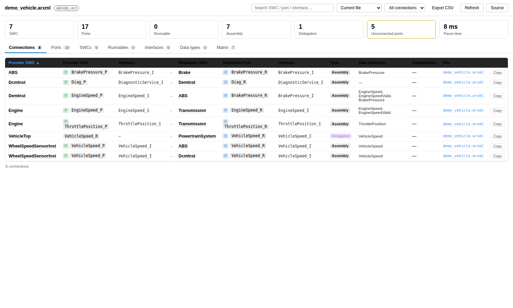
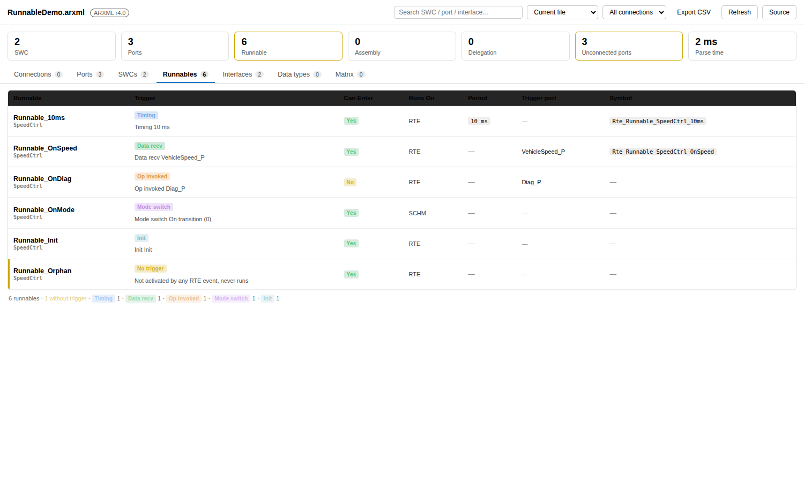
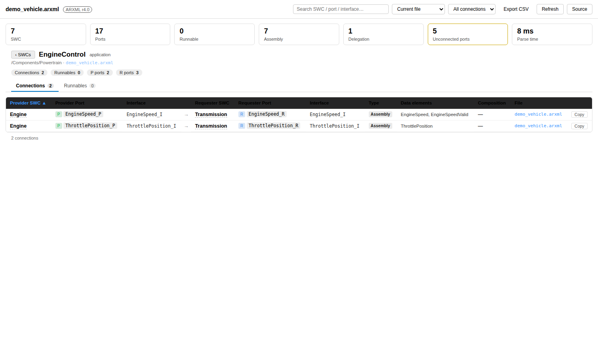
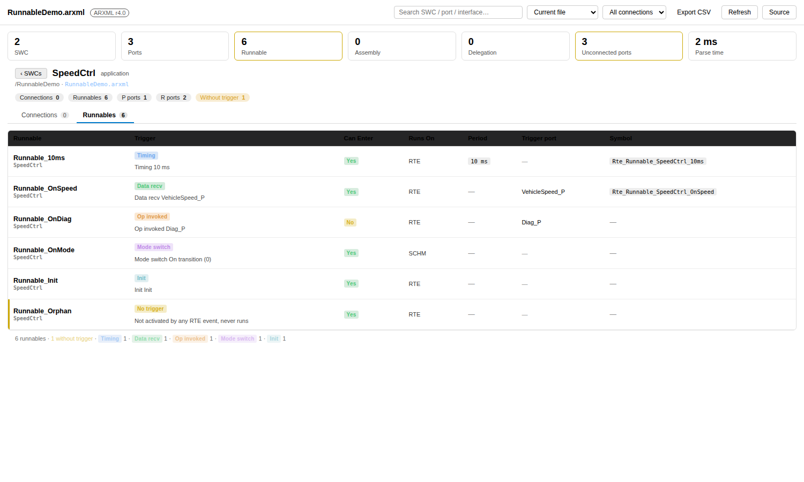
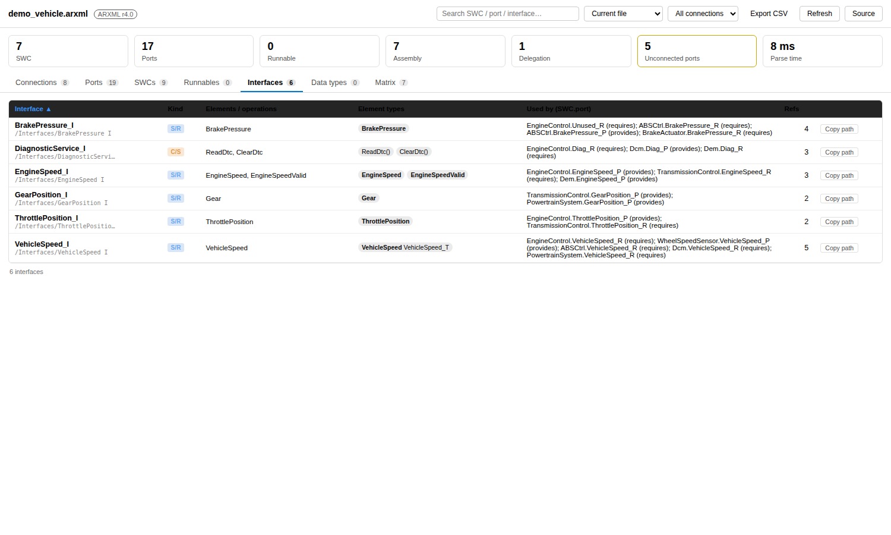
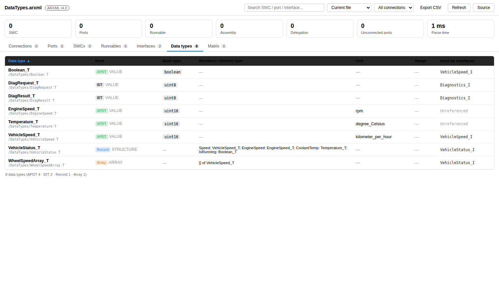
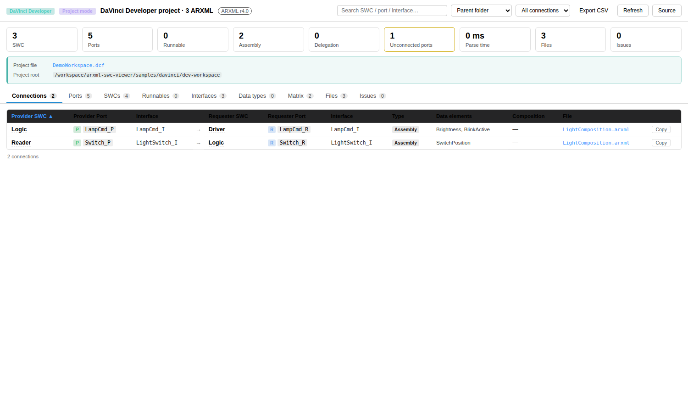
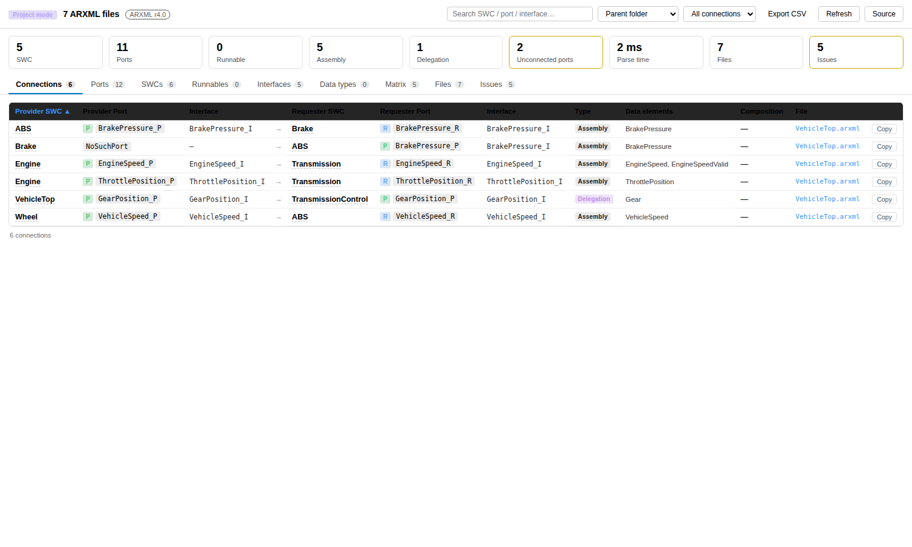
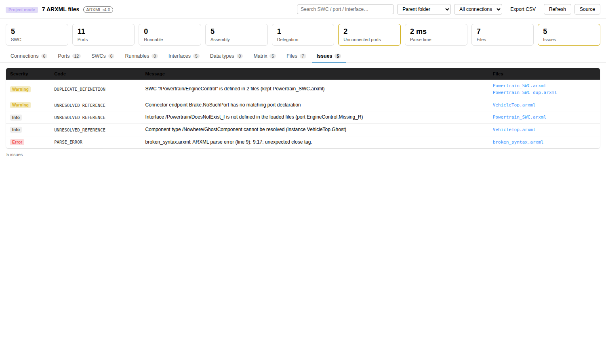

# AUTOSAR ARXML SWC Viewer

Parse AUTOSAR ARXML files (R4.x) and inspect SWC (software component) port connections in a table view.



## Runnable & Trigger View (v0.5.0)

A dedicated **Runnables** tab shows every runnable inside each component together with its **triggering mechanism**:

- Colour-coded trigger badges: timing / data received / operation invoked / mode switch / init / send complete / async return / external trigger / background loop
- **Timing events** are unit-normalised automatically (`0.01` → `10 ms`); mode-switch events keep their transition description
- Data-received and operation-invoked events resolve the **triggering port** (e.g. `VehicleSpeed_P`), so you can follow the data path directly
- `CAN-ENTER` (Yes/No badge), `RUNS-ON` (RTE / SCHM …), minimum start interval and `SYMBOL` are all displayed
- **Orphan runnables are highlighted**: a runnable not activated by any RTE event is marked *No trigger* and counted as a warning in the status bar
- Handles `SWC-INTERNAL-BEHAVIOR` short names without polluting the component name, and tolerates any declaration order of events vs. runnables



## Per-SWC Detail: Connections vs. Runnables (v0.7.0)

Every SWC name in the tables (SWCs, Ports, Connections, Runnables) is now a link into a
**component detail page** where the two concerns are split into separate sub-tabs:

- **Connections** — only the connections this component takes part in (as provider, requester, or via its composition instance)
- **Runnables** — only the runnables of this component, with their triggers, CAN-ENTER, Runs-On, symbols

The detail header shows the component type, package path, source file, and chips for
connection / runnable / P-port / R-port counts (plus a warning chip when orphan runnables exist).
Back navigation returns to the SWC list; connectors matched by instance name resolve to the component type automatically.





## Interface & Data Type Views (v0.4.0)

Two dedicated views answer the question "what is actually carried by this port?":

- **Interfaces view**: one row per interface, with S/R or C/S kind badge, service flag, all data elements / operation signatures, and a **Used by** column
  (which `SWC.port` entries reference the interface — makes unused interfaces easy to spot)
- **Data types view**: covers APDT / IDT / Record / Array, showing base type,
  unit, compu method, record members (listed as `member: type`), array element type,
  plus a **Used by interfaces** column (type ↔ interface traceability in both directions)
- The element type column renders `Speed: VehicleSpeed_T [APDT]` as a type pill, so the chain is readable at a glance
- The status bar gained an interface counter; global search and column sorting work on both new views





## Vector DaVinci Project Support (v0.3.0)

Open a Vector DaVinci project file directly and the referenced ARXML files are discovered automatically:

| Project file | Tool | Discovery strategy |
|---|---|---|
| `.dcf` | DaVinci Developer | `<FILEREF><ARXML>` file references + `<EXTERNALFILEREF>` nested workspaces loaded recursively |
| `.dpa` | DaVinci Configurator 5 | `<InputFiles>` / `<Folder>` scan + auto-discovery of `Config/Developer/*.dcf` workspaces |
| `.dvjson` | DaVinci Configurator 6 | Directory keys in `Settings/ArxmlProjectContent.json` + `references.dvWorkspace` in `General.json`, falling back to the default folder layout |

- The title shows the tool badge (DaVinci Developer / Configurator); the project banner lists the project file, root folder, linked workspaces and scanned folders
- Missing referenced files are reported as warnings only; a broken project file produces a clear error
- Right-click a `.dcf/.dpa/.dvjson` file → **Open Vector DaVinci Project**, or run `ARXML: Open Vector DaVinci Project` from the command palette
- Relative path resolution follows DaVinci conventions: `.dcf` resolves against its own folder, v6 settings JSON against the settings file folder



## Multi-file Project Mode (v0.2.0)

Real AUTOSAR projects are split across many ARXML files. The extension can treat a set of files as **one project**:

- Right-click an `.arxml` file → **Open in Project Mode**, or switch the scope from the view toolbar (current file / containing folder / whole workspace / pick a folder)
- Definitions are merged by full AUTOSAR path, and cross-file references are resolved (port ↔ interface, composition instance ↔ component type, connector endpoints)
- **Issues panel**: duplicate definitions (first wins, with a warning), unresolved references, broken files, dangling connector endpoints
- **Files panel**: per-file SWC / port / connection / interface / element counts and parse time; the connection table gains a *File* column that jumps to the source
- A single broken file never aborts the whole parse; CSV export includes the file list and the issue list





## Performance

Measured on a generated large project (reproduce with `npm run bench`):

| Scale | File size | Parse | View build | Total |
|---|---|---|---|---|
| 50 SWC × 50 ports | 2.4 MB | 116 ms | 42 ms | 158 ms |
| **100 SWC × 100 ports × 10 data elements** | **9.5 MB** | **347 ms** | **81 ms** | **429 ms** |
| 200 SWC × 100 ports × 10 data elements | 18.9 MB | 677 ms | 162 ms | 839 ms |

- Throughput is roughly **27 MB/s**, and time grows linearly with input size (O(n))
- Memory stays flat: a model with 100k data elements takes ~28 MB; repeated parses show no leak
- Optimisations: runnable/event association went from O(components × events) to a hash index, `shortNameOf` dropped its regex, hot-path regexes were hoisted to constants, and `opentag` got a fast path for irrelevant tags

## Features

- **Connections table**: Provider SWC / Port → Requester SWC / Port, with interface kind, data elements, Assembly / Delegation type and owning composition
- **Ports list**: direction (P/R), interface, and connection state (connected / unconnected) for every SWC
- **SWC overview**: component type, package path, P/R port counts, connection count
- **Interfaces view**: data elements, operation parameters (IN/OUT), service flag and references for S/R and C/S interfaces
- **Data types view**: base type, unit, range, members and reference chain for APDT / IDT / Record / Array
- **Runnables view**: runnable list, trigger mechanism (timing / data received / operation invoked / mode switch / init), CAN-ENTER, Runs-On
- **Connection matrix**: Provider × Requester heat map with port mapping on hover
- Full-text search, column sorting, connection-kind filter, one-click copy of the connection path
- CSV export (with BOM, so Excel opens it without mojibake)
- Large-file friendly: SAX streaming parser, 3000 components / 42000 elements in ~55 ms

## Installation / Deployment

### 1. Install from a prebuilt package (end users)

Download `arxml-swc-viewer-0.7.0.vsix`, then install it in one of three ways:

```bash
# a) VS Code CLI
code --install-extension arxml-swc-viewer-0.7.0.vsix

# b) VS Code Insiders / Codium / VSCodium — same flag, different binary
codium --install-extension arxml-swc-viewer-0.7.0.vsix

# c) Force reinstall/upgrade an existing copy
code --install-extension arxml-swc-viewer-0.7.0.vsix --force
```

GUI equivalent: **Extensions** view → `…` menu → **Install from VSIX…** → pick the file.
After installing, reload the window (**Developer: Reload Window**).

Silent / fleet deployment (offline machines, shared images):

```bash
# install for all users on Linux/macOS
sudo code --install-extension arxml-swc-viewer-0.7.0.vsix --force

# Windows (per-user install path)
code --install-extension arxml-swc-viewer-0.7.0.vsix --force
# extension lands in %USERPROFILE%\.vscode\extensions
```

Verify the install: `code --list-extensions | grep arxml-swc-viewer` should print
`arxml-tools.arxml-swc-viewer`.

### 2. Build the package from source (release engineer)

```bash
npm install
npm run compile
npm test           # optional but recommended before shipping
npm run package    # produces arxml-swc-viewer-<version>.vsix
```

`npm run package` runs `tsc` first (via `vscode:prepublish`) and then `@vscode/vsce package`.
Bump `version` in `package.json` before each release — VS Code refuses to upgrade to the same version.

### 3. Run from source without packaging (development)

1. Open the project folder in VS Code.
2. Press <kbd>F5</kbd> — this starts an **Extension Development Host** window with the extension loaded
   (the launch config compiles first; if you have no `launch.json`, use
   **Run → Start Debugging → VS Code Extension**).
3. In that window open `samples/demo_vehicle.arxml` and right-click → **Open With** → `ARXML SWC Viewer`.
4. Change webview code (`media/*.js`, `media/*.css`) → **Developer: Reload Window** in the host window;
   change `src/*.ts` → restart the debug session (or run `npm run watch` in a terminal).

### 4. Publish to the Marketplace (optional)

```bash
npx @vscode/vsce login arxml-tools        # personal access token from dev.azure.com
npx @vscode/vsce publish                  # uses the current version in package.json
npx @vscode/vsce publish minor            # or bump + publish in one step
```

Requires a publisher in the Marketplace portal matching the `publisher` field in `package.json`.
For an internal/private feed, `vsce publish -p <token>` against your own registry, or ship the `.vsix`
through your software distribution channel.

## Usage

1. Right-click an `.arxml` file in the Explorer → **Open With** → `ARXML SWC Viewer`,
   or click the table icon in the editor title bar
2. Click any SWC name to open its per-component Connections / Runnables page
3. Command palette: `ARXML: Export Connections as CSV`

## Supported ARXML Elements

- All `*-SW-COMPONENT-TYPE` variants (Application / Service / CDD / ECU-A / Sensor-Actuator / NV, etc.)
- `COMPOSITION-SW-COMPONENT-TYPE` + `COMPONENT-PROTOTYPE` (instance name → type name mapping built automatically)
- `ASSEMBLY-SW-CONNECTOR` (CONTEXT-COMPONENT-REF + TARGET-PORT-REF)
- `DELEGATION-SW-CONNECTOR` (both INNER-PORT-IREF and OUTER-PORT-REF forms)
- `SWC-INTERNAL-BEHAVIOR` + `RUNNABLE-ENTITY` (CAN-ENTER / RUNS-ON / MINIMUM-START-INTERVAL / SYMBOL)
- RTE events: `TIMING-EVENT` / `DATA-RECEIVED-EVENT` / `OPERATION-INVOKED-EVENT` / `SWC-MODE-SWITCH-EVENT` / `INIT-EVENT` / `BACKGROUND-EVENT` / `DATA-SEND-COMPLETED-EVENT` / `ASYNCHRONOUS-SERVER-CALL-RETURNS-EVENT` / `EXTERNAL-TRIGGER-OCCURRED-EVENT`
- Interface definitions such as `SENDER-RECEIVER-INTERFACE` / `CLIENT-SERVER-INTERFACE` (data elements, operation arguments)
- Data type definitions: `APPLICATION-PRIMITIVE/RECORD/ARRAY-DATA-TYPE`, `IMPLEMENTATION-DATA-TYPE` (base type, unit, compu method, members)

## Settings

| Setting | Description |
|---|---|
| `arxmlSwc.excludePatterns` | Regex array of component short names to ignore |
| `arxmlSwc.showUnconnectedPorts` | Whether the ports table lists unconnected ports |
| `arxmlSwc.projectMode` | Enable project mode by default when opening the view |
| `arxmlSwc.projectScope` | Project scope: `folder` (default) or `workspace` |
| `arxmlSwc.projectIgnore` | Glob patterns ignored during project scanning |

## Development

```bash
npm install        # install dependencies
npm run compile    # compile TypeScript to out/
npm run watch      # incremental compile in the background
npm run lint       # type-check only, no emit
npm test           # run parser tests (no VS Code required)
npm run bench      # performance benchmark (100k data elements)
npm run package    # build the .vsix
```

Samples: `samples/demo_vehicle.arxml` (single file), `samples/project/` (multi-file project), and `samples/davinci/`
(DaVinci Developer workspace plus Configurator v5 / v6 projects — three formats). The demo covers powertrain + chassis + diagnostic services: 7 SWCs / 2 compositions / 8 connections.

## Known Limitations

- Read-only view; ARXML files are never edited
- PORT-OPTIONAL / MODE declaration details are not parsed; interface data elements are capped at 8 per interface
- Refreshes on file save, not keystroke-level incremental parsing
